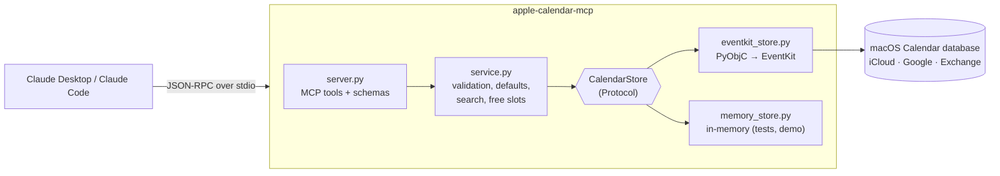

# apple-calendar-mcp

[](https://github.com/oguz-kagan-gocmez-edu/apple-calendar-mcp/actions/workflows/ci.yml)


A [Model Context Protocol](https://modelcontextprotocol.io) server that lets Claude **read and manage your Apple Calendar**: list your schedule, find free time, and create, move or delete events, including recurring ones.

It talks to macOS through Apple's **EventKit** framework. That is the same database Calendar.app uses, so every account synced on your Mac (iCloud, Google, Exchange, your university's Outlook) shows up through one interface. Nothing leaves your machine except what Claude reads in the conversation.

```text
You:    Find me two free hours this week for the CS350 project, then block them.
Claude: ▸ get_time_context  ▸ find_free_slots  ▸ create_event
        Booked "CS350 project" Thu 13:00–15:00 in Work. Wednesday 09:00–11:00 was also free.
```

## Features

| Tool | What it does | Kind |
|---|---|---|
| `get_time_context` | Current local date, time and time zone, so "next Friday" resolves correctly | read |
| `list_calendars` | Calendars with account, colour and whether they're writable | read |
| `list_events` | Events in a range, with recurring events expanded into occurrences | read |
| `search_events` | Case-insensitive search across title, location and notes; all terms must match | read |
| `get_event` | Full details, including attendees and repeat rule | read |
| `find_free_slots` | Gaps of at least *N* minutes within working hours, skipping weekends if you want | read |
| `create_event` | Timed or all-day events, with alarms, URL and repeat rules | write |
| `update_event` | Partial edits. Recurring events take `span`: `this`, `future` or `all` | write |
| `delete_event` | Delete one occurrence, this and later ones, or the whole series | destructive |

Other parts of the design:

- **Tool annotations.** Each tool is marked read-only or destructive, so clients can ask you before they change anything.
- **`--read-only` mode.** Runs the server without the write tools at all.
- **Prompt-injection hygiene.** The server tells the model that event text is untrusted data. Anyone who sends you an invite controls that text.
- **Typed output.** Every tool returns JSON with a published output schema, generated from pydantic models.

## How it works



- **`server.py`** declares the tools. The function signatures and pydantic `Field` descriptions become the JSON Schema Claude sees. The file contains no logic.
- **`service.py`** turns loose model input into precise requests. It parses ISO 8601, fills defaults (a 1-hour duration, all-day ranges, search windows), keeps the duration when only the start time moves, and builds search and free-slot finding on top of plain CRUD.
- **`CalendarStore`** is a six-method protocol. The EventKit backend is the real one. The in-memory backend reproduces EventKit's recurrence semantics, so the entire service and MCP layer is tested on Linux CI.
- **`scheduling.py`** finds free slots with interval arithmetic: sort, merge the busy intervals, then sweep each day with two pointers. That is O(n log n + d) for n events over d days.

### Design decisions worth knowing

- **Occurrence ids.** EventKit gives every occurrence of a recurring event the same `eventIdentifier`. Ids here are `"<eventIdentifier>|<original start>"`, built from EventKit's `occurrenceDate`. Each id therefore points at exactly one occurrence, even after that occurrence has been moved.
- **`span = all`.** EventKit only has *this* and *future* spans. *All* is implemented as *future* applied to the first occurrence. The target occurrence's time change is converted into the same shift for the whole series.
- **Exclusive ends.** For an all-day event on 3 Nov, `end` is `2026-11-04T00:00`, the same convention as iCalendar `DTEND`. EventKit internally reports `23:59:59` on the last day, so the backend normalises in both directions. On input, an all-day `end` is the *inclusive* last date, because that is how people say it ("5th to 7th").
- **Concurrency.** The MCP SDK runs sync tools on worker threads. All EventKit calls go through one lock, and each call runs inside an Objective-C autorelease pool.

## Requirements

- macOS 13 or later (macOS 14+ uses the newer full-access permission API)
- Python 3.11+ and [uv](https://docs.astral.sh/uv/)
- Claude Desktop or Claude Code

## Setup

```bash
git clone https://github.com/oguz-kagan-gocmez-edu/apple-calendar-mcp.git
cd apple-calendar-mcp
uv sync
uv run apple-calendar-mcp install-app   # builds the helper app that holds calendar permission
uv run apple-calendar-mcp doctor        # asks for permission, lists your calendars
```

`doctor` triggers a macOS prompt for **"Apple Calendar MCP"**. Choose **Allow Full Access**. You only do this once: Claude Desktop, Claude Code and Terminal all reuse that permission. `install-app` needs the Xcode Command Line Tools (`xcode-select --install`).

### Claude Desktop

Open **Settings → Developer → Edit Config** and add the server (template: [`examples/claude_desktop_config.json`](examples/claude_desktop_config.json)):

```json
{
  "mcpServers": {
    "apple-calendar": {
      "command": "/opt/homebrew/bin/uv",
      "args": ["--directory", "/Users/YOU/Projects/apple-calendar-mcp", "run", "apple-calendar-mcp"]
    }
  }
}
```

Use absolute paths. Run `which uv` to find yours. Quit Claude Desktop completely (⌘Q) and reopen it.

### Claude Code

```bash
claude mcp add apple-calendar -s user -- uv --directory /Users/YOU/Projects/apple-calendar-mcp run apple-calendar-mcp
```

### Options

```
apple-calendar-mcp [--read-only] [--timezone Europe/Istanbul] [--log-level INFO]
apple-calendar-mcp --backend memory --demo     # fake data, no Mac needed
apple-calendar-mcp doctor
apple-calendar-mcp install-app [--dest PATH]
```

## macOS permissions (read this if nothing works)

macOS protects calendars with TCC (Transparency, Consent and Control). It asks on behalf of the **responsible app**: normally the GUI app that started the process. Since macOS 14 that app must declare `NSCalendarsFullAccessUsageDescription` in its Info.plist, or the request is **refused without any prompt**. Terminal and Claude don't declare it, so running the server directly fails with *"macOS refused calendar access without showing a prompt"*.

`install-app` fixes this. It builds `~/Applications/Apple Calendar MCP.app`, a tiny ad-hoc-signed bundle with no Dock icon. The bundle declares calendar access and contains a ~70-line C launcher ([`launcher.c`](src/apple_calendar_mcp/macos_helper/launcher.c)). When the bundle is installed, `apple-calendar-mcp` re-runs itself through the launcher. The launcher makes the bundle responsible for its own permissions, so macOS asks for "Apple Calendar MCP" whichever app started the server. Your Claude config doesn't change.

- Choose **Allow Full Access**. "Add Events Only" is not enough to read your events.
- To change your answer later: **System Settings → Privacy & Security → Calendars → Apple Calendar MCP**.
- `doctor` shows whether the helper app is in use. Set `APPLE_CALENDAR_MCP_NO_APP=1` to bypass it.
- Rebuilding the app (for example after an upgrade) may ask for permission once more.
- Without a GUI session (SSH, launchd), the prompt can never appear. The server times out after 30 s with a clear error instead of hanging.

## Try it without a Mac

The in-memory backend serves a realistic fake week, which is handy with the [MCP Inspector](https://github.com/modelcontextprotocol/inspector):

```bash
npx @modelcontextprotocol/inspector uv run apple-calendar-mcp --backend memory --demo
```

## Development

```bash
uv sync --group dev
uv run pytest --cov=apple_calendar_mcp   # 116 tests
uv run ruff check . && uv run ruff format --check .
uv run mypy src                          # strict
```

The test suite has five layers:

| Layer | File | What it covers |
|---|---|---|
| Unit | `test_timeutil_recurrence.py`, `test_scheduling.py` | ISO parsing, DST-safe recurrence expansion, interval merging and free slots |
| Service | `test_service.py` | Create, update and delete validation, plus `this` / `future` / `all` semantics on recurring series |
| Protocol | `test_server.py` | Full lifecycle over a real MCP client session, schemas, annotations, error mapping |
| Backend | `test_eventkit_mapping.py` | The EventKit backend running on a fake PyObjC layer: permission flow, all-day conversion, recurrence-rule mapping |
| CLI | `test_cli.py`, `test_macos_app.py` | Backend selection, `--read-only` and `--demo`, `doctor` output, and building the helper app and relaunching through it |

CI runs on Ubuntu (Python 3.11–3.13) and macOS. The macOS job also imports the real PyObjC bindings and builds and signs the helper app.

### Manual check on a Mac

CI cannot click "Allow" in a permission dialog. Before a release, run through this list:

1. `uv run apple-calendar-mcp doctor` shows all your accounts' calendars.
2. In Claude: "What's on my calendar this week?" The results match Calendar.app.
3. Create a test event. It appears in Calendar.app within a few seconds and syncs to your phone.
4. Create a weekly test event. Move one occurrence (`this`), then rename the rest (`future`), and check Calendar.app.
5. Delete the series (`all`).

## Limitations and roadmap

- **No invitations.** EventKit cannot add attendees. Attendees are read-only.
- **Recurrence subset.** Repeat rules support daily, weekly (with weekdays), monthly and yearly frequency, with an interval and a count or until date. More complex rules created in Calendar.app (for example "last Friday of the month") are reported in simplified form.
- **Reminders** are not supported yet. EventKit exposes them through the same store, so this would be a natural next step.
- **Remote connector.** A CalDAV backend for iCloud would implement the same `CalendarStore` protocol and could be served over streamable HTTP. That would let it work as a claude.ai custom connector on web and mobile.

## License

MIT © Oğuz Kağan Göçmez
