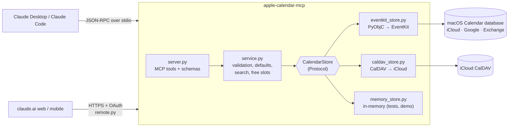
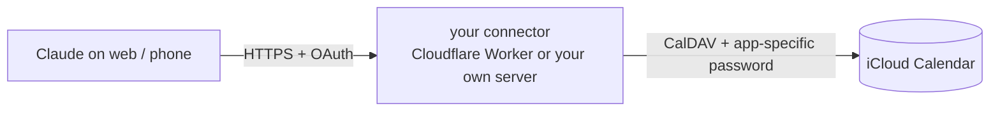

# apple-calendar-mcp

[](https://github.com/oguz-kagan-gocmez-edu/apple-calendar-mcp/actions/workflows/ci.yml)


A [Model Context Protocol](https://modelcontextprotocol.io) server that lets Claude **read and manage your Apple Calendar**: list your schedule, find free time, and create, move or delete events, including recurring ones.

It talks to macOS through Apple's **EventKit** framework. That is the same database Calendar.app uses, so every account synced on your Mac (iCloud, Google, Exchange, your university's Outlook) shows up through one interface. Nothing leaves your machine except what Claude reads in the conversation.

It can also run as a **remote connector** for claude.ai on the web and on your phone: your own small server that talks to iCloud over CalDAV and signs Claude in with OAuth. See [Remote connector](#remote-connector-claudeai-web-and-mobile).

<!-- mcp-name: io.github.oguz-kagan-gocmez-edu/apple-calendar-mcp -->

```text
You:    Find me two free hours this week for the CS350 project, then block them.
Claude: ▸ get_time_context  ▸ find_free_slots  ▸ create_event
        Booked "CS350 project" Thu 13:00–15:00 in Work. Wednesday 09:00–11:00 was also free.

You:    What does my day look like?
Claude: ▸ agenda
        Lecture until 12:00, then lunch, which overlaps it by 30 minutes. You're free
        12:30–16:00. The 16:00 design review is still waiting for your reply.
```

## Features

| Tool | What it does | Kind |
|---|---|---|
| `get_time_context` | Current local date, time and time zone, so "next Friday" resolves correctly | read |
| `list_calendars` | Calendars with account, colour and whether they're writable | read |
| `list_events` | Events in a range, with recurring events expanded into occurrences | read |
| `search_events` | Case-insensitive search across title, location and notes; all terms must match | read |
| `get_event` | Full details, including attendees and repeat rule | read |
| `agenda` | A day (or up to 14) in one call: what's on now and next, all-day items, busy minutes, free gaps left, overlaps and unanswered invitations | read |
| `find_conflicts` | Double bookings: pairs of events that overlap and both take the time | read |
| `calendar_stats` | Where the time goes in a range: busy time per day and weekday, in and out of working hours, per calendar, and the titles that take the most time | read |
| `find_duplicates` | Events that look like copies of each other (same title, start and end), across calendars; copied repeating series come back as one group | read |
| `export_ics` | A date range as iCalendar (.ics) text, to share or move to another app; repeating events come out as one event per occurrence | read |
| `import_ics` | Add the events from .ics text, skipping ones already in the calendar; the whole import is one undoable change, and anything it can't represent exactly is listed with the reason | write |
| `find_free_slots` | Gaps of at least *N* minutes within working hours, with an optional buffer around other events, skipping weekends if you want | read |
| `create_event` | Timed or all-day events, with alarms, URL and repeat rules | write |
| `update_event` | Partial edits. Recurring events take `span`: `this`, `future` or `all` | write |
| `delete_event` | Delete one occurrence, this and later ones, or the whole series | destructive |
| `apply_changes` | Up to 25 creates, updates and deletes in one go, all-or-nothing: everything is checked first, and a failure part-way rolls back the rest | destructive |
| `undo_change` | Undo the latest change (or one picked from `list_changes`), including a whole batch | destructive |
| `list_changes` | Recent changes made through the server, and whether each can be undone | read |
| `respond_to_invitation` | Accept, decline or tentatively accept an invitation, for the whole series or one occurrence (iCloud/CalDAV backend only) | write |
| `list_reminder_lists` | Your Apple Reminders lists (macOS only) | read |
| `list_reminders` | Open, completed or all reminders, soonest due first, with `overdue` marked; filter by list, due date or words | read |
| `create_reminder` | Add a reminder with an optional due date or date and time, notes and priority | write |
| `update_reminder` | Change title, notes, due date, priority or list; mark done or not done | write |
| `complete_reminder` | Tick a reminder off (or back on) | write |
| `delete_reminder` | Delete a reminder | destructive |

Other parts of the design:

- **Free/busy that matches reality.** Free time, busy minutes and conflicts ignore all-day events, events marked *free*, canceled events and invitations you declined. Invitations you haven't answered still count as busy, and `agenda` lists them separately.
- **Tool annotations.** Each tool is marked read-only or destructive, so clients can ask you before they change anything.
- **`--read-only` mode.** Runs the server without the write tools at all.
- **Answer invitations.** On the iCloud (CalDAV) backend and the remote connector, `respond_to_invitation` sets your reply and iCloud tells the organizer. It needs the sign-in name to be the email address the invitation was sent to. EventKit gives apps no way to reply, so on the Mac backend the tool is not offered; answer in the Calendar app there. Replies are not in the undo log, because the organizer has already been told.
- **Reminders, on the Mac.** The reminder tools use Apple Reminders through EventKit, with their own macOS permission that is asked for only the first time a reminder tool is used. A due time also sets an alert then, as the Reminders app does. iCloud doesn't serve reminders over CalDAV any more, so the CalDAV backend and the remote connector don't offer these tools. Reminder changes are not in the undo log. `--no-reminders` (or `APPLE_CALENDAR_NO_REMINDERS=1`) leaves the tools out, and the per-calendar access options apply to reminder lists by id or title too.
- **Undo that won't clobber anything.** Every write is logged with the event before and after. Undo restores it exactly, or refuses: if the event was edited again since, or if the change can't be reversed exactly (edits to several occurrences of a repeating event, a deleted occurrence, a deleted invitation whose invites can't be resent). The log keeps the last 50 changes, in memory on your Mac.
- **Per-calendar access.** Mark calendars read-only, or hide them from Claude entirely. See [Choosing which calendars Claude can touch](#choosing-which-calendars-claude-can-touch).
- **Prompt-injection hygiene.** The server tells the model that event text is untrusted data. Anyone who sends you an invite controls that text.
- **Typed output.** Every tool returns JSON with a published output schema, generated from pydantic models.

## How it works



- **`server.py`** declares the tools. The function signatures and pydantic `Field` descriptions become the JSON Schema Claude sees. The file contains no logic.
- **`service.py`** turns loose model input into precise requests. It parses ISO 8601, fills defaults (a 1-hour duration, all-day ranges, search windows), keeps the duration when only the start time moves, and builds search and free-slot finding on top of plain CRUD.
- **`CalendarStore`** is a six-method protocol with three backends. EventKit is the local one. CalDAV powers the remote connector. The in-memory backend reproduces the recurrence semantics both of them follow, so the service and MCP layers are tested on Linux CI.
- **`remote.py`** serves the same tools over streamable HTTP, behind a single-owner OAuth authorization server (dynamic client registration, PKCE, rotating refresh tokens, hashed storage).
- **`scheduling.py`** finds free slots with interval arithmetic: sort, merge the busy intervals, then sweep each day with two pointers. That is O(n log n + d) for n events over d days.

### Design decisions worth knowing

- **Occurrence ids.** EventKit gives every occurrence of a recurring event the same `eventIdentifier`. Ids here are `"<eventIdentifier>|<original start>"`, built from EventKit's `occurrenceDate`. Each id therefore points at exactly one occurrence, even after that occurrence has been moved.
- **`span = all`.** EventKit only has *this* and *future* spans. *All* is implemented as *future* applied to the first occurrence. The target occurrence's time change is converted into the same shift for the whole series.
- **Exclusive ends.** For an all-day event on 3 Nov, `end` is `2026-11-04T00:00`, the same convention as iCalendar `DTEND`. EventKit internally reports `23:59:59` on the last day, so the backend normalises in both directions. On input, an all-day `end` is the *inclusive* last date, because that is how people say it ("5th to 7th").
- **Concurrency.** The MCP SDK runs sync tools on worker threads. All EventKit calls go through one lock, and each call runs inside an Objective-C autorelease pool.

## Requirements

- macOS 13 or later (macOS 14+ uses the newer full-access permission API)
- Python 3.11+ and [uv](https://docs.astral.sh/uv/)
- Claude Desktop or Claude Code

## Claude plugin

The quickest way to use it in **Claude Code** (and in **Cowork** sessions that run on your Mac) is the plugin. It adds the server and a short skill that teaches Claude the workflow and the one-time permission setup. Install it in Claude Code:

```text
/plugin install apple-calendar-mcp --marketplace oguz-kagan-gocmez-edu/apple-calendar-mcp
```

On Claude Code older than 2.1.275, add the marketplace first:

```text
/plugin marketplace add oguz-kagan-gocmez-edu/apple-calendar-mcp
/plugin install apple-calendar-mcp@apple-calendar-mcp
```

You need [uv](https://docs.astral.sh/uv/) on your `PATH`. The first start takes a little longer while uv installs the dependencies.

Then do the permission setup once. Ask Claude to *"set up calendar access"* and it runs `install-app` and `doctor` for you, or run them yourself as in [Setup](#setup). The plugin runs from source, so its `install-app` compiles the helper and needs the Xcode Command Line Tools; without them, `uvx apple-calendar-eventkit-mcp install-app` installs the same helper prebuilt, and the plugin uses it. If you set up the helper app before, the plugin reuses it. See [macOS permissions](#macos-permissions-read-this-if-nothing-works) for what the helper app is.

Plain chats on claude.ai, the desktop app and phones don't run local servers. For those, use the [remote connector](#remote-connector-claudeai-web-and-mobile).

### What the plugin runs and sends

- **What it starts.** Claude Code runs `uv run --locked --no-dev --project <plugin folder> apple-calendar-mcp`. On the first start uv installs the exact dependency versions from `uv.lock` (`mcp`, `pydantic`, `pyobjc-framework-EventKit` and what they need) from PyPI into a `.venv` inside the plugin folder, and downloads Python 3.11+ if none is installed. After a plugin update this happens once more.
- **What it reads and writes.** The server only talks to macOS EventKit, the calendar database on your Mac. It makes no network requests of its own, keeps no copy of your events and writes no logs to disk. Events leave your Mac only as tool results inside your Claude conversation.
- **Changes to your calendar.** Only through `create_event`, `update_event` and `delete_event`. They are marked as write and destructive tools, so Claude asks before running them. Start the server with `--read-only` to remove them.
- **The helper app.** `install-app` runs only when you (or Claude, with your go-ahead) run it. It writes the ad-hoc-signed `~/Applications/Apple Calendar MCP.app` around a ~70-line C launcher: compiled with `clang` from a checkout, or prebuilt in the PyPI package. Delete that app to remove it.
- **No accounts or credentials.** The plugin asks for no passwords or tokens. Your calendar accounts stay configured in macOS.

This is an unofficial project and isn't affiliated with Apple.

## Setup

```bash
git clone https://github.com/oguz-kagan-gocmez-edu/apple-calendar-mcp.git
cd apple-calendar-mcp
uv sync
uv run apple-calendar-mcp install-app   # builds the helper app that holds calendar permission
uv run apple-calendar-mcp doctor        # asks for permission, lists your calendars
```

`doctor` triggers a macOS prompt for **"Apple Calendar MCP"**. Choose **Allow Full Access**. You only do this once: Claude Desktop, Claude Code and Terminal all reuse that permission. From a clone, `install-app` compiles the launcher, so it needs the Xcode Command Line Tools (`xcode-select --install`). The PyPI package below doesn't.

### Without cloning (PyPI)

The server is also on PyPI as [`apple-calendar-eventkit-mcp`](https://pypi.org/project/apple-calendar-eventkit-mcp/), so `uvx` can run it without a clone. This is the easiest setup: the package carries the helper's launcher prebuilt (for Apple silicon and Intel), so nothing is compiled and Xcode isn't needed:

```bash
uvx apple-calendar-eventkit-mcp install-app
uvx apple-calendar-eventkit-mcp doctor
claude mcp add apple-calendar -s user -- uvx apple-calendar-eventkit-mcp
```

In Claude Desktop, use `"command": "/opt/homebrew/bin/uvx"` and `"args": ["apple-calendar-eventkit-mcp"]` (run `which uvx` for your path). The PyPI name differs from the repository's because `apple-calendar-mcp` was already taken there; the command inside stays `apple-calendar-mcp`.

### Claude Desktop

Open **Settings → Developer → Edit Config** and add the server (template: [`examples/claude_desktop_config.json`](examples/claude_desktop_config.json)):

```json
{
  "mcpServers": {
    "apple-calendar": {
      "command": "/opt/homebrew/bin/uv",
      "args": ["--directory", "/Users/YOU/Projects/apple-calendar-mcp", "run", "apple-calendar-mcp"]
    }
  }
}
```

Use absolute paths. Run `which uv` to find yours. Quit Claude Desktop completely (⌘Q) and reopen it.

### Claude Code

```bash
claude mcp add apple-calendar -s user -- uv --directory /Users/YOU/Projects/apple-calendar-mcp run apple-calendar-mcp
```

### Options

```
apple-calendar-mcp [--read-only] [--no-reminders] [--timezone Europe/Istanbul] [--log-level INFO]
apple-calendar-mcp --backend memory --demo     # fake data, no Mac needed
apple-calendar-mcp doctor
apple-calendar-mcp install-app [--dest PATH] [--from-source]
apple-calendar-mcp --backend caldav doctor     # iCloud over CalDAV (CALDAV_* env vars)
apple-calendar-mcp serve-http [--host H] [--port P]   # remote connector, see below
```

### Choosing which calendars Claude can touch

Three options, each a comma-separated list of calendar ids or titles (`doctor` prints both):

| Option | Environment variable | Effect |
|---|---|---|
| `--read-only-calendars` | `APPLE_CALENDAR_READ_ONLY_CALENDARS` | Claude can read these but can't create, change, move or delete anything in them |
| `--hidden-calendars` | `APPLE_CALENDAR_HIDDEN_CALENDARS` | Claude can't see these at all: not in `list_calendars`, no events, ids act as if they don't exist, and their time counts as free |
| `--only-calendars` | `APPLE_CALENDAR_ONLY_CALENDARS` | Shows only these; every other calendar is hidden |

Titles are matched case-insensitively and match every calendar with that title, so use the id when two accounts have a calendar with the same name. If a calendar is in both lists, hidden wins. For example, in Claude Desktop's config:

```json
"args": ["--read-only-calendars", "Work", "--hidden-calendars", "Family,Therapy"]
```

`doctor` shows each calendar as `[rw]`, `[ro]` or `[hidden]` with your settings applied, and warns about names that match nothing (usually a typo). The checks run in front of the backend, so every tool goes through them.

## macOS permissions (read this if nothing works)

macOS protects calendars with TCC (Transparency, Consent and Control). It asks on behalf of the **responsible app**: normally the GUI app that started the process. Since macOS 14 that app must declare `NSCalendarsFullAccessUsageDescription` in its Info.plist, or the request is **refused without any prompt**. Terminal and Claude don't declare it, so running the server directly fails with *"macOS refused calendar access without showing a prompt"*.

`install-app` fixes this. It builds `~/Applications/Apple Calendar MCP.app`, a tiny ad-hoc-signed bundle with no Dock icon. The bundle declares calendar access and contains a ~70-line C launcher ([`launcher.c`](src/apple_calendar_mcp/macos_helper/launcher.c)). Releases on PyPI ship that launcher prebuilt, compiled from the same commit by the [release workflow](.github/workflows/release.yml) on GitHub's macOS runners; from a git checkout it's compiled locally. Pass `--from-source` to compile it yourself either way. When the bundle is installed, `apple-calendar-mcp` re-runs itself through the launcher. The launcher makes the bundle responsible for its own permissions, so macOS asks for "Apple Calendar MCP" whichever app started the server. Your Claude config doesn't change.

- Choose **Allow Full Access**. "Add Events Only" is not enough to read your events.
- Reminders have their own permission. macOS asks for it the first time a reminder tool runs (or when `doctor` checks reminders). A helper app installed before reminder support doesn't declare it: run `install-app` again, then `doctor`.
- To change your answer later: **System Settings → Privacy & Security → Calendars** (or **Reminders**) **→ Apple Calendar MCP**.
- The helper app can't read files under Desktop, Documents, Downloads or iCloud Drive, so it isn't used when the server runs from a checkout there; `doctor` says so. Move the checkout (for example to `~/src`) or install from PyPI.
- `doctor` shows whether the helper app is in use. Set `APPLE_CALENDAR_MCP_NO_APP=1` to bypass it.
- Rebuilding the app (for example after an upgrade) may ask for permission once more.
- Without a GUI session (SSH, launchd), the prompt can never appear. The server times out after 30 s with a clear error instead of hanging.

## Remote connector (claude.ai web and mobile)

The local server only works where it runs: your Mac. To use your calendar from claude.ai in a browser or the Claude phone app, run your own copy of the **remote connector**. It talks to iCloud over CalDAV and is added to Claude as a custom connector. The easiest home for it is Cloudflare's free Workers plan: no server, no card, always on.



Each person runs their own copy with their own credentials. Nobody else holds your Apple ID details.

### 1. Create an app-specific password
At [appleid.apple.com](https://appleid.apple.com) go to **Sign-In and Security → App-Specific Passwords** and create one called "Claude calendar". You can revoke it there at any time.

### 2. Deploy it

#### Free, on Cloudflare Workers (recommended)
The `worker/` folder is the same connector written for [Cloudflare Workers](https://developers.cloudflare.com/workers/): same tools, same sign-in page. The free plan is plenty for one person (100,000 requests a day) and needs no card. You don't need a Mac for this, only [Node.js](https://nodejs.org) 22 or newer and [git](https://git-scm.com).

1. Get the code:
   ```bash
   git clone https://github.com/oguz-kagan-gocmez-edu/apple-calendar-mcp.git
   cd apple-calendar-mcp/worker && npm ci
   ```
2. Create a free account at [dash.cloudflare.com](https://dash.cloudflare.com/sign-up). Then sign in from the terminal, giving Wrangler only the four permissions this needs (plain `wrangler login` asks for access to your whole account):
   ```bash
   npx wrangler login --use-keyring --scopes account:read user:read workers_scripts:write workers_kv:write
   ```
   `--use-keyring` keeps the token in your OS keychain instead of a plain file.
3. Set your time zone: `TZ` in `worker/wrangler.jsonc` (an IANA name such as `Europe/Istanbul` or `America/New_York`).
4. Deploy:
   ```bash
   npx wrangler deploy
   ```
   The first deploy creates the storage for sign-ins (`OAUTH_KV`) and, if your account has none yet, a `workers.dev` subdomain. It prints your address, `https://apple-calendar-mcp.<your-subdomain>.workers.dev`. Your connector URL is that address plus `/mcp`.
5. Add the secrets. Each command asks for the value; it is stored encrypted at Cloudflare, can't be read back, and takes effect at once:
   ```bash
   npx wrangler secret put CALDAV_USERNAME     # your Apple ID email
   npx wrangler secret put CALDAV_PASSWORD     # the app-specific password from step 1 above
   npx wrangler secret put CONNECTOR_PASSWORD  # a new random password, 12+ characters; you'll type it once when connecting
   ```
   To make the connector password without it ever showing on screen (macOS; it lands in your clipboard for your password manager):
   ```bash
   openssl rand -hex 24 | tr -d '\n' | tee >(pbcopy) | npx wrangler secret put CONNECTOR_PASSWORD
   ```
6. Check it: `https://<your address>/healthz` should show `{"ok":true}`. Then sign out of Wrangler:
   ```bash
   npx wrangler logout
   ```

**Updating.** Only changes to the code (`worker/src`) or to `wrangler.jsonc` need a deploy: `git pull`, log in as in step 2, `npx wrangler deploy`, log out. Changing a secret needs only `npx wrangler secret put …`.

**Troubleshooting.** `npx wrangler tail` shows the live log (passwords and tokens are never logged).
- *"This connector isn't set up yet"* (HTTP 503): the log says which setting is missing or invalid. A `CONNECTOR_PASSWORD` that is short or still the example from `.env.example` is refused on purpose.
- *"The CalDAV server rejected the login"*: `CALDAV_USERNAME` or `CALDAV_PASSWORD` is wrong. Apple shows an app-specific password only once, and revokes all of them when you change your Apple ID password. Create a new one and run `npx wrangler secret put CALDAV_PASSWORD` again. No redeploy or reconnect is needed.
- *No "App-Specific Passwords" on the Apple page*: turn on two-factor authentication for your Apple ID first. School or work (managed) Apple IDs can't create them.
- *Claude asks permission before each change*: that's claude.ai confirming tools that change your calendar. You can set the read-only tools to "Always allow" under Settings → Connectors.

#### Or run the Python server yourself
Configure it:
```bash
cp .env.example .env
```
Fill in `CALDAV_USERNAME` (your Apple ID), `CALDAV_PASSWORD` (the app-specific password), `PUBLIC_URL` (the https address of your server), `CONNECTOR_PASSWORD` (a long random string you'll type once when connecting) and `TZ`.

Check the iCloud side before deploying:
```bash
uv sync --extra remote
uv run --env-file .env apple-calendar-mcp --backend caldav doctor
```

Then run it with Docker, on any host:
```bash
docker compose up -d
```
Or without Docker: `uv run --env-file .env apple-calendar-mcp serve-http`.

claude.ai only connects to **https** addresses. Use your host's HTTPS (Fly.io, Render, Railway and similar give you one), a reverse proxy like Caddy, or, to try it from your own computer, a tunnel:
```bash
cloudflared tunnel --url http://localhost:8000
```
Put the `https://….trycloudflare.com` address it prints into `PUBLIC_URL` and restart the server. (Quick tunnels get a new address each time; use a named tunnel or a host for something permanent.)

**On a server with Caddy (Google Cloud VM).**
`docker-compose.https.yml` adds [Caddy](https://caddyserver.com), which gets the HTTPS certificate by itself. Any small Linux server with a public IP works; Google Cloud's always-free `e2-micro` (us-west1, us-central1 or us-east1) is enough:
```bash
gcloud compute instances create calendar-mcp --zone=us-central1-a --machine-type=e2-micro \
  --image-family=debian-12 --image-project=debian-cloud --boot-disk-size=30GB \
  --boot-disk-type=pd-standard --tags=https-server
gcloud compute firewall-rules create allow-web --allow=tcp:80,tcp:443,udp:443 --target-tags=https-server
gcloud compute scp deploy/gcp/setup-vm.sh calendar-mcp:~ --zone=us-central1-a
gcloud compute ssh calendar-mcp --zone=us-central1-a --command='bash setup-vm.sh'
```
The script installs Docker, clones the repo and tells you what to put in `.env`. No domain needed: `<ip-with-dashes>.sslip.io` points at your IP. Then, on the server:
```bash
docker compose -f docker-compose.yml -f docker-compose.https.yml up -d --build
```
Set a billing budget alert: Google's free tier rules can change, and the public IP may be billed.

### 3. Add it to Claude
In claude.ai: **Settings → Connectors → Add custom connector**. Enter your connector URL (`https://…workers.dev/mcp`, or `https://<your server>/mcp`), click **Connect**, and type your `CONNECTOR_PASSWORD` on the page that opens. The connector now appears in your connectors list on web, desktop and mobile.

### Security notes
- Claude gets in only through OAuth. Registration accepts only Claude's own redirect URIs. `http://localhost` (for the MCP Inspector) is allowed only when `PUBLIC_URL` is itself localhost, or with `OAUTH_ALLOW_LOCALHOST=1`.
- The login page names the site the sign-in will return to, compares the password in constant time, and locks out after repeated failures (5 per IP, 20 overall, per 15 minutes). The server refuses to start with the example password from `.env.example`.
- Access tokens last 1 hour, refresh tokens 30 days and rotate on every use. If an old refresh token is ever replayed, the whole grant is revoked and you sign in again. Codes and tokens are stored only as SHA-256 hashes in `DATA_DIR/auth.db` (owner-only permissions).
- On Cloudflare Workers, `/register` and `/authorize` are rate limited per client IP (10 a minute), so scripted abuse can't burn through the free plan's daily KV write quota and block sign-ins.
- Public endpoints are bounded: a flood of client registrations can't push out a signed-in Claude, and unfinished sign-ins are capped.
- Host and Origin headers are checked against `PUBLIC_URL`. Logs never contain credentials, tokens or event contents.
- The Docker setup runs as a non-root user with a read-only filesystem, no Linux capabilities, and the port bound to `127.0.0.1` so only your HTTPS proxy reaches it.
- `--read-only` works here too, if you want Claude on the web to only read your calendar (on Workers: `"READ_ONLY": "1"` in `wrangler.jsonc`).
- Undo works here too. On Cloudflare Workers the change log is kept in Workers KV (each request starts fresh), so the before and after copies of changed events stay there for 24 hours, then expire.
- Per-calendar access works here too: set the `APPLE_CALENDAR_*_CALENDARS` variables (see [Choosing which calendars Claude can touch](#choosing-which-calendars-claude-can-touch)). On Workers they are `READ_ONLY_CALENDARS`, `HIDDEN_CALENDARS` and `ONLY_CALENDARS` in `wrangler.jsonc`.
- On Cloudflare Workers, OAuth is handled by Cloudflare's [`workers-oauth-provider`](https://github.com/cloudflare/workers-oauth-provider): tokens are stored hashed in Workers KV and props are encrypted with the token. The same rules apply (Claude-only redirect URIs, 1 hour access tokens, 30 day rotating refresh tokens, lockout), with two differences: an old refresh token keeps working until its replacement is first used, and the lockout counter lives in KV, which is eventually consistent, so the limit is approximate.

### What the remote connector can't see
It reads **iCloud** calendars only. Google, Exchange or university calendars that your Mac syncs through Calendar.app are not on iCloud, so only the local (EventKit) server sees them. Subscribed calendars and Birthdays are not available over CalDAV either.

## Try it without a Mac

The in-memory backend serves a realistic fake week, which is handy with the [MCP Inspector](https://github.com/modelcontextprotocol/inspector):

```bash
npx @modelcontextprotocol/inspector uv run apple-calendar-mcp --backend memory --demo
```

## Development

```bash
uv sync --group dev --extra remote
uv run pytest --cov=apple_calendar_mcp   # 190 tests (CalDAV ones run against a local Radicale server)
uv run ruff check . && uv run ruff format --check .
uv run mypy src                          # strict
```

The test suite has six layers:

| Layer | File | What it covers |
|---|---|---|
| Unit | `test_timeutil_recurrence.py`, `test_scheduling.py` | ISO parsing, DST-safe recurrence expansion, interval merging and free slots |
| Service | `test_service.py` | Create, update and delete validation, `this` / `future` / `all` semantics on recurring series, agenda, conflicts and buffered free time; `test_access.py` covers per-calendar read-only and hidden calendars through every tool; `test_changes.py` covers undo and batches, and also runs against CalDAV |
| Protocol | `test_server.py` | Full lifecycle over a real MCP client session, schemas, annotations, error mapping |
| Backend | `test_eventkit_mapping.py`, `test_caldav_store.py` | EventKit on a fake PyObjC layer. CalDAV against a real Radicale server, re-running every service scenario plus iCalendar mapping (overrides, EXDATE, all-day, alarms, RRULE) |
| Remote | `test_remote_auth.py` | The whole OAuth flow (registration, login, PKCE, refresh rotation, revocation, expiry, lockout) and tool calls over streamable HTTP |
| CLI | `test_cli.py`, `test_macos_app.py` | Backend selection, `--read-only` and `--demo`, `doctor` output, and building the helper app and relaunching through it |

The Cloudflare Worker has its own TypeScript suite (`cd worker && npm test`): the same service scenarios against Radicale, recurrence and DST checks, a CPU budget check (the free plan allows 10 ms of CPU per request), and the OAuth flow and MCP tools inside `workerd`, the real Workers runtime.

CI runs on Ubuntu (Python 3.11–3.13) and macOS. The macOS job also imports the real PyObjC bindings and builds and signs the helper app. A Docker job builds the remote-connector image and checks it starts and requires a token. A Worker job type-checks, lints, tests and builds the Cloudflare Worker.

### Manual check on a Mac

CI cannot click "Allow" in a permission dialog. Before a release, run through this list:

1. `uv run apple-calendar-mcp doctor` shows all your accounts' calendars.
2. In Claude: "What's on my calendar this week?" The results match Calendar.app.
3. Create a test event. It appears in Calendar.app within a few seconds and syncs to your phone.
4. Create a weekly test event. Move one occurrence (`this`), then rename the rest (`future`), and check Calendar.app.
5. Delete the series (`all`).
6. `doctor` asks for Reminders access and lists your reminder lists. Ask Claude to add a reminder for tomorrow at 9:00: it appears in Reminders.app with an alert, then complete and delete it.

## Limitations and roadmap

- **No sending invitations.** Attendees can't be added or removed. Answering an invitation you received works on the iCloud (CalDAV) backend only.
- **Recurrence subset.** Repeat rules support daily, weekly (with weekdays), monthly and yearly frequency, with an interval and a count or until date. More complex rules created in Calendar.app (for example "last Friday of the month") are reported in simplified form.
- **Reminders are macOS only.** Repeating reminders are shown but their rules can't be edited, and subtasks, tags, locations and early alerts aren't covered.
- **Remote connector is self-hosted.** Each person runs their own copy (a free Cloudflare Worker or a server). A shared, multi-user service listed in Claude's connector directory would need encrypted per-user credential storage and Anthropic's review.

## License

MIT © Oğuz Kağan Göçmez
