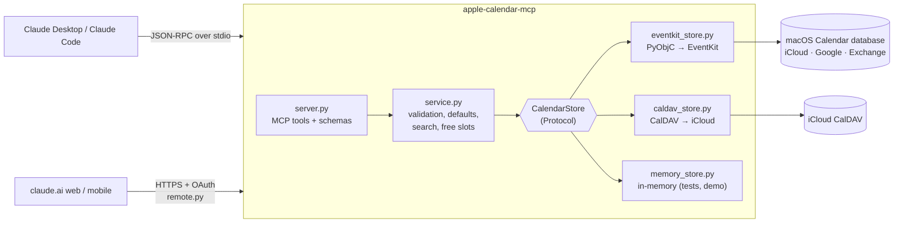
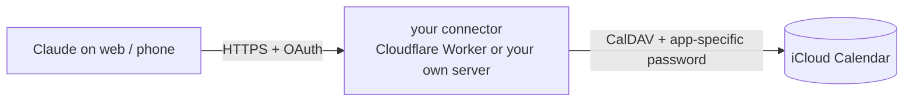

# apple-calendar-mcp

[](https://github.com/oguz-kagan-gocmez-edu/apple-calendar-mcp/actions/workflows/ci.yml)


A [Model Context Protocol](https://modelcontextprotocol.io) server that lets Claude **read and manage your Apple Calendar**: list your schedule, find free time, and create, move or delete events, including recurring ones.

It talks to macOS through Apple's **EventKit** framework. That is the same database Calendar.app uses, so every account synced on your Mac (iCloud, Google, Exchange, your university's Outlook) shows up through one interface. Nothing leaves your machine except what Claude reads in the conversation.

It can also run as a **remote connector** for claude.ai on the web and on your phone: your own small server that talks to iCloud over CalDAV and signs Claude in with OAuth. See [Remote connector](#remote-connector-claudeai-web-and-mobile).

```text
You:    Find me two free hours this week for the CS350 project, then block them.
Claude: ▸ get_time_context  ▸ find_free_slots  ▸ create_event
        Booked "CS350 project" Thu 13:00–15:00 in Work. Wednesday 09:00–11:00 was also free.
```

## Features

| Tool | What it does | Kind |
|---|---|---|
| `get_time_context` | Current local date, time and time zone, so "next Friday" resolves correctly | read |
| `list_calendars` | Calendars with account, colour and whether they're writable | read |
| `list_events` | Events in a range, with recurring events expanded into occurrences | read |
| `search_events` | Case-insensitive search across title, location and notes; all terms must match | read |
| `get_event` | Full details, including attendees and repeat rule | read |
| `find_free_slots` | Gaps of at least *N* minutes within working hours, skipping weekends if you want | read |
| `create_event` | Timed or all-day events, with alarms, URL and repeat rules | write |
| `update_event` | Partial edits. Recurring events take `span`: `this`, `future` or `all` | write |
| `delete_event` | Delete one occurrence, this and later ones, or the whole series | destructive |

Other parts of the design:

- **Tool annotations.** Each tool is marked read-only or destructive, so clients can ask you before they change anything.
- **`--read-only` mode.** Runs the server without the write tools at all.
- **Prompt-injection hygiene.** The server tells the model that event text is untrusted data. Anyone who sends you an invite controls that text.
- **Typed output.** Every tool returns JSON with a published output schema, generated from pydantic models.

## How it works



- **`server.py`** declares the tools. The function signatures and pydantic `Field` descriptions become the JSON Schema Claude sees. The file contains no logic.
- **`service.py`** turns loose model input into precise requests. It parses ISO 8601, fills defaults (a 1-hour duration, all-day ranges, search windows), keeps the duration when only the start time moves, and builds search and free-slot finding on top of plain CRUD.
- **`CalendarStore`** is a six-method protocol with three backends. EventKit is the local one. CalDAV powers the remote connector. The in-memory backend reproduces the recurrence semantics both of them follow, so the service and MCP layers are tested on Linux CI.
- **`remote.py`** serves the same tools over streamable HTTP, behind a single-owner OAuth authorization server (dynamic client registration, PKCE, rotating refresh tokens, hashed storage).
- **`scheduling.py`** finds free slots with interval arithmetic: sort, merge the busy intervals, then sweep each day with two pointers. That is O(n log n + d) for n events over d days.

### Design decisions worth knowing

- **Occurrence ids.** EventKit gives every occurrence of a recurring event the same `eventIdentifier`. Ids here are `"<eventIdentifier>|<original start>"`, built from EventKit's `occurrenceDate`. Each id therefore points at exactly one occurrence, even after that occurrence has been moved.
- **`span = all`.** EventKit only has *this* and *future* spans. *All* is implemented as *future* applied to the first occurrence. The target occurrence's time change is converted into the same shift for the whole series.
- **Exclusive ends.** For an all-day event on 3 Nov, `end` is `2026-11-04T00:00`, the same convention as iCalendar `DTEND`. EventKit internally reports `23:59:59` on the last day, so the backend normalises in both directions. On input, an all-day `end` is the *inclusive* last date, because that is how people say it ("5th to 7th").
- **Concurrency.** The MCP SDK runs sync tools on worker threads. All EventKit calls go through one lock, and each call runs inside an Objective-C autorelease pool.

## Requirements

- macOS 13 or later (macOS 14+ uses the newer full-access permission API)
- Python 3.11+ and [uv](https://docs.astral.sh/uv/)
- Claude Desktop or Claude Code

## Setup

```bash
git clone https://github.com/oguz-kagan-gocmez-edu/apple-calendar-mcp.git
cd apple-calendar-mcp
uv sync
uv run apple-calendar-mcp install-app   # builds the helper app that holds calendar permission
uv run apple-calendar-mcp doctor        # asks for permission, lists your calendars
```

`doctor` triggers a macOS prompt for **"Apple Calendar MCP"**. Choose **Allow Full Access**. You only do this once: Claude Desktop, Claude Code and Terminal all reuse that permission. `install-app` needs the Xcode Command Line Tools (`xcode-select --install`).

### Claude Desktop

Open **Settings → Developer → Edit Config** and add the server (template: [`examples/claude_desktop_config.json`](examples/claude_desktop_config.json)):

```json
{
  "mcpServers": {
    "apple-calendar": {
      "command": "/opt/homebrew/bin/uv",
      "args": ["--directory", "/Users/YOU/Projects/apple-calendar-mcp", "run", "apple-calendar-mcp"]
    }
  }
}
```

Use absolute paths. Run `which uv` to find yours. Quit Claude Desktop completely (⌘Q) and reopen it.

### Claude Code

```bash
claude mcp add apple-calendar -s user -- uv --directory /Users/YOU/Projects/apple-calendar-mcp run apple-calendar-mcp
```

### Options

```
apple-calendar-mcp [--read-only] [--timezone Europe/Istanbul] [--log-level INFO]
apple-calendar-mcp --backend memory --demo     # fake data, no Mac needed
apple-calendar-mcp doctor
apple-calendar-mcp install-app [--dest PATH]
apple-calendar-mcp --backend caldav doctor     # iCloud over CalDAV (CALDAV_* env vars)
apple-calendar-mcp serve-http [--host H] [--port P]   # remote connector, see below
```

## macOS permissions (read this if nothing works)

macOS protects calendars with TCC (Transparency, Consent and Control). It asks on behalf of the **responsible app**: normally the GUI app that started the process. Since macOS 14 that app must declare `NSCalendarsFullAccessUsageDescription` in its Info.plist, or the request is **refused without any prompt**. Terminal and Claude don't declare it, so running the server directly fails with *"macOS refused calendar access without showing a prompt"*.

`install-app` fixes this. It builds `~/Applications/Apple Calendar MCP.app`, a tiny ad-hoc-signed bundle with no Dock icon. The bundle declares calendar access and contains a ~70-line C launcher ([`launcher.c`](src/apple_calendar_mcp/macos_helper/launcher.c)). When the bundle is installed, `apple-calendar-mcp` re-runs itself through the launcher. The launcher makes the bundle responsible for its own permissions, so macOS asks for "Apple Calendar MCP" whichever app started the server. Your Claude config doesn't change.

- Choose **Allow Full Access**. "Add Events Only" is not enough to read your events.
- To change your answer later: **System Settings → Privacy & Security → Calendars → Apple Calendar MCP**.
- `doctor` shows whether the helper app is in use. Set `APPLE_CALENDAR_MCP_NO_APP=1` to bypass it.
- Rebuilding the app (for example after an upgrade) may ask for permission once more.
- Without a GUI session (SSH, launchd), the prompt can never appear. The server times out after 30 s with a clear error instead of hanging.

## Remote connector (claude.ai web and mobile)

The local server only works where it runs: your Mac. To use your calendar from claude.ai in a browser or the Claude phone app, run your own copy of the **remote connector**. It talks to iCloud over CalDAV and is added to Claude as a custom connector. The easiest home for it is Cloudflare's free Workers plan: no server, no card, always on.



Each person runs their own copy with their own credentials. Nobody else holds your Apple ID details.

### 1. Create an app-specific password
At [appleid.apple.com](https://appleid.apple.com) go to **Sign-In and Security → App-Specific Passwords** and create one called "Claude calendar". You can revoke it there at any time.

### 2. Deploy it

#### Free, on Cloudflare Workers (recommended)
The `worker/` folder is the same connector written for [Cloudflare Workers](https://developers.cloudflare.com/workers/): same tools, same sign-in page. The free plan is plenty for one person (100,000 requests a day) and needs no card. You need Node.js 22 or newer.

1. Create a free account at [dash.cloudflare.com](https://dash.cloudflare.com/sign-up), then sign in from the terminal:
   ```bash
   cd worker && npm ci && npx wrangler login
   ```
2. Create the storage for sign-ins and paste the `id` it prints into `worker/wrangler.jsonc` (`kv_namespaces`):
   ```bash
   npx wrangler kv namespace create OAUTH_KV
   ```
   Set your time zone (`TZ`) in the same file.
3. Add the secrets. Each command asks for the value; it is stored encrypted at Cloudflare and never in a file:
   ```bash
   npx wrangler secret put CALDAV_USERNAME     # your Apple ID email
   npx wrangler secret put CALDAV_PASSWORD     # the app-specific password
   npx wrangler secret put CONNECTOR_PASSWORD  # a long random string you'll type once when connecting
   ```
4. Deploy:
   ```bash
   npx wrangler deploy
   ```
   It prints your address, `https://apple-calendar-mcp.<your-account>.workers.dev`. Your connector URL is that address plus `/mcp`.

To update later, `git pull` and run `npx wrangler deploy` again. `npx wrangler tail` shows live logs.

#### Or run the Python server yourself
Configure it:
```bash
cp .env.example .env
```
Fill in `CALDAV_USERNAME` (your Apple ID), `CALDAV_PASSWORD` (the app-specific password), `PUBLIC_URL` (the https address of your server), `CONNECTOR_PASSWORD` (a long random string you'll type once when connecting) and `TZ`.

Check the iCloud side before deploying:
```bash
uv sync --extra remote
uv run --env-file .env apple-calendar-mcp --backend caldav doctor
```

Then run it with Docker, on any host:
```bash
docker compose up -d
```
Or without Docker: `uv run --env-file .env apple-calendar-mcp serve-http`.

claude.ai only connects to **https** addresses. Use your host's HTTPS (Fly.io, Render, Railway and similar give you one), a reverse proxy like Caddy, or, to try it from your own computer, a tunnel:
```bash
cloudflared tunnel --url http://localhost:8000
```
Put the `https://….trycloudflare.com` address it prints into `PUBLIC_URL` and restart the server. (Quick tunnels get a new address each time; use a named tunnel or a host for something permanent.)

**On a server with Caddy (Google Cloud VM).**
`docker-compose.https.yml` adds [Caddy](https://caddyserver.com), which gets the HTTPS certificate by itself. Any small Linux server with a public IP works; Google Cloud's always-free `e2-micro` (us-west1, us-central1 or us-east1) is enough:
```bash
gcloud compute instances create calendar-mcp --zone=us-central1-a --machine-type=e2-micro \
  --image-family=debian-12 --image-project=debian-cloud --boot-disk-size=30GB \
  --boot-disk-type=pd-standard --tags=https-server
gcloud compute firewall-rules create allow-web --allow=tcp:80,tcp:443,udp:443 --target-tags=https-server
gcloud compute scp deploy/gcp/setup-vm.sh calendar-mcp:~ --zone=us-central1-a
gcloud compute ssh calendar-mcp --zone=us-central1-a --command='bash setup-vm.sh'
```
The script installs Docker, clones the repo and tells you what to put in `.env`. No domain needed: `<ip-with-dashes>.sslip.io` points at your IP. Then, on the server:
```bash
docker compose -f docker-compose.yml -f docker-compose.https.yml up -d --build
```
Set a billing budget alert: Google's free tier rules can change, and the public IP may be billed.

### 3. Add it to Claude
In claude.ai: **Settings → Connectors → Add custom connector**. Enter your connector URL (`https://…workers.dev/mcp`, or `https://<your server>/mcp`), click **Connect**, and type your `CONNECTOR_PASSWORD` on the page that opens. The connector now appears in your connectors list on web, desktop and mobile.

### Security notes
- Claude gets in only through OAuth. Registration accepts only Claude's own redirect URIs. `http://localhost` (for the MCP Inspector) is allowed only when `PUBLIC_URL` is itself localhost, or with `OAUTH_ALLOW_LOCALHOST=1`.
- The login page names the site the sign-in will return to, compares the password in constant time, and locks out after repeated failures (5 per IP, 20 overall, per 15 minutes). The server refuses to start with the example password from `.env.example`.
- Access tokens last 1 hour, refresh tokens 30 days and rotate on every use. If an old refresh token is ever replayed, the whole grant is revoked and you sign in again. Codes and tokens are stored only as SHA-256 hashes in `DATA_DIR/auth.db` (owner-only permissions).
- Public endpoints are bounded: a flood of client registrations can't push out a signed-in Claude, and unfinished sign-ins are capped.
- Host and Origin headers are checked against `PUBLIC_URL`. Logs never contain credentials, tokens or event contents.
- The Docker setup runs as a non-root user with a read-only filesystem, no Linux capabilities, and the port bound to `127.0.0.1` so only your HTTPS proxy reaches it.
- `--read-only` works here too, if you want Claude on the web to only read your calendar (on Workers: `"READ_ONLY": "1"` in `wrangler.jsonc`).
- On Cloudflare Workers, OAuth is handled by Cloudflare's [`workers-oauth-provider`](https://github.com/cloudflare/workers-oauth-provider): tokens are stored hashed in Workers KV and props are encrypted with the token. The same rules apply (Claude-only redirect URIs, 1 hour access tokens, 30 day rotating refresh tokens, lockout), with two differences: an old refresh token keeps working until its replacement is first used, and the lockout counter lives in KV, which is eventually consistent, so the limit is approximate.

### What the remote connector can't see
It reads **iCloud** calendars only. Google, Exchange or university calendars that your Mac syncs through Calendar.app are not on iCloud, so only the local (EventKit) server sees them. Subscribed calendars and Birthdays are not available over CalDAV either.

## Try it without a Mac

The in-memory backend serves a realistic fake week, which is handy with the [MCP Inspector](https://github.com/modelcontextprotocol/inspector):

```bash
npx @modelcontextprotocol/inspector uv run apple-calendar-mcp --backend memory --demo
```

## Development

```bash
uv sync --group dev --extra remote
uv run pytest --cov=apple_calendar_mcp   # 190 tests (CalDAV ones run against a local Radicale server)
uv run ruff check . && uv run ruff format --check .
uv run mypy src                          # strict
```

The test suite has six layers:

| Layer | File | What it covers |
|---|---|---|
| Unit | `test_timeutil_recurrence.py`, `test_scheduling.py` | ISO parsing, DST-safe recurrence expansion, interval merging and free slots |
| Service | `test_service.py` | Create, update and delete validation, plus `this` / `future` / `all` semantics on recurring series |
| Protocol | `test_server.py` | Full lifecycle over a real MCP client session, schemas, annotations, error mapping |
| Backend | `test_eventkit_mapping.py`, `test_caldav_store.py` | EventKit on a fake PyObjC layer. CalDAV against a real Radicale server, re-running every service scenario plus iCalendar mapping (overrides, EXDATE, all-day, alarms, RRULE) |
| Remote | `test_remote_auth.py` | The whole OAuth flow (registration, login, PKCE, refresh rotation, revocation, expiry, lockout) and tool calls over streamable HTTP |
| CLI | `test_cli.py`, `test_macos_app.py` | Backend selection, `--read-only` and `--demo`, `doctor` output, and building the helper app and relaunching through it |

The Cloudflare Worker has its own TypeScript suite (`cd worker && npm test`): the same service scenarios against Radicale, recurrence and DST checks, a CPU budget check (the free plan allows 10 ms of CPU per request), and the OAuth flow and MCP tools inside `workerd`, the real Workers runtime.

CI runs on Ubuntu (Python 3.11–3.13) and macOS. The macOS job also imports the real PyObjC bindings and builds and signs the helper app. A Docker job builds the remote-connector image and checks it starts and requires a token. A Worker job type-checks, lints, tests and builds the Cloudflare Worker.

### Manual check on a Mac

CI cannot click "Allow" in a permission dialog. Before a release, run through this list:

1. `uv run apple-calendar-mcp doctor` shows all your accounts' calendars.
2. In Claude: "What's on my calendar this week?" The results match Calendar.app.
3. Create a test event. It appears in Calendar.app within a few seconds and syncs to your phone.
4. Create a weekly test event. Move one occurrence (`this`), then rename the rest (`future`), and check Calendar.app.
5. Delete the series (`all`).

## Limitations and roadmap

- **No invitations.** EventKit cannot add attendees. Attendees are read-only.
- **Recurrence subset.** Repeat rules support daily, weekly (with weekdays), monthly and yearly frequency, with an interval and a count or until date. More complex rules created in Calendar.app (for example "last Friday of the month") are reported in simplified form.
- **Reminders** are not supported yet. EventKit exposes them through the same store, so this would be a natural next step.
- **Remote connector is self-hosted.** Each person runs their own copy (a free Cloudflare Worker or a server). A shared, multi-user service listed in Claude's connector directory would need encrypted per-user credential storage and Anthropic's review.

## License

MIT © Oğuz Kağan Göçmez
